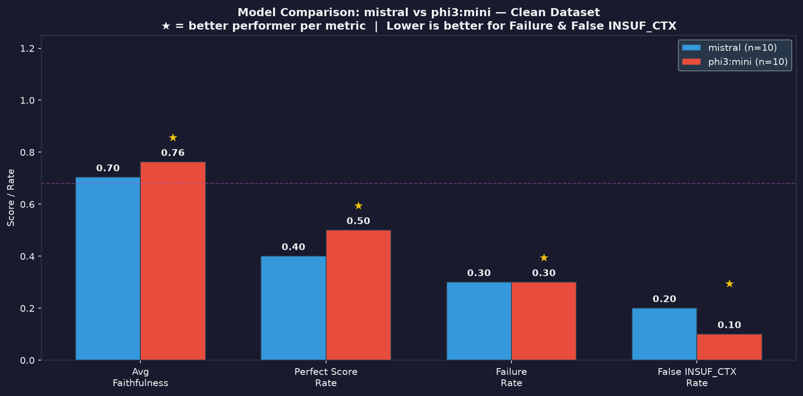
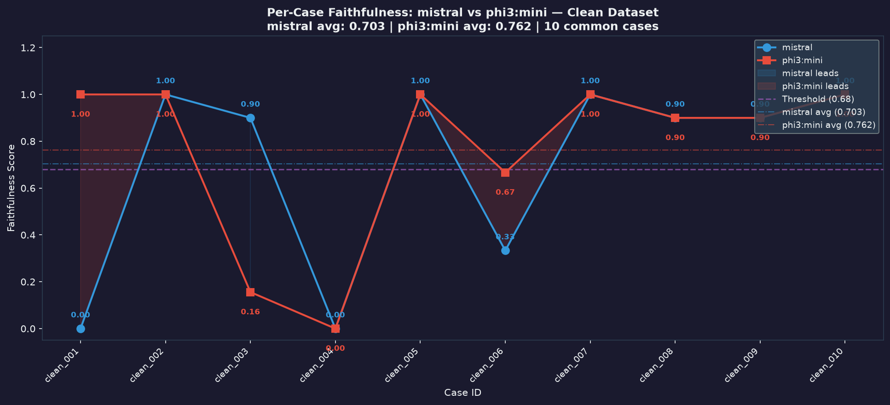
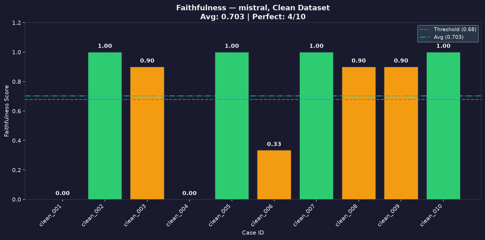
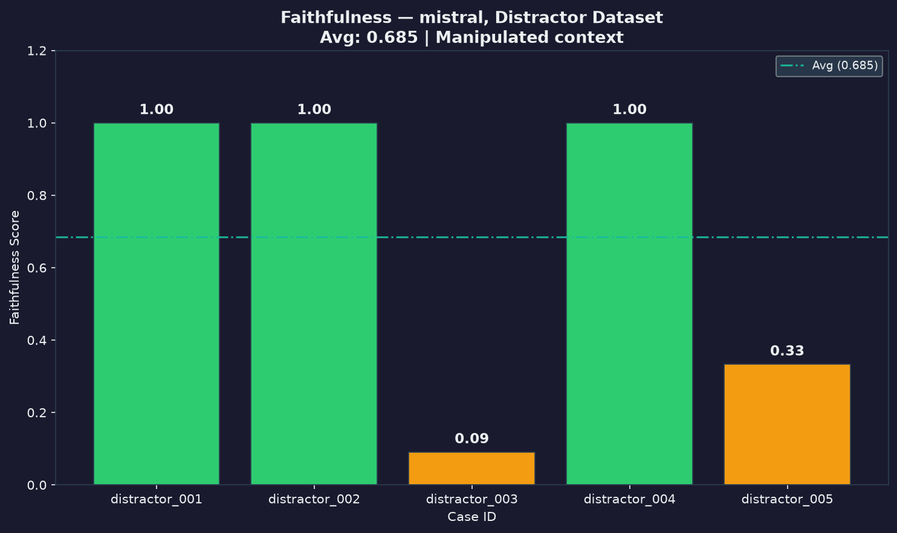
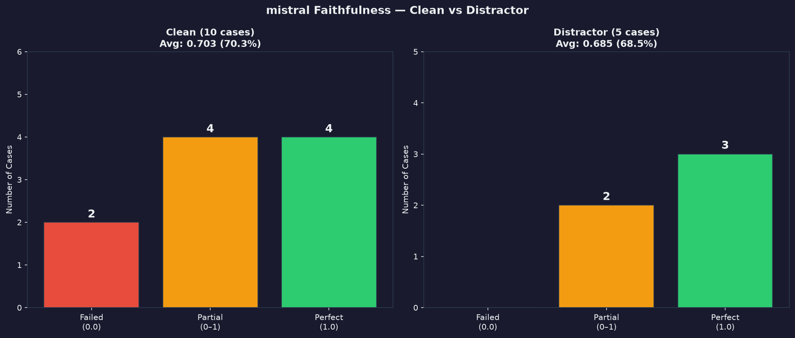
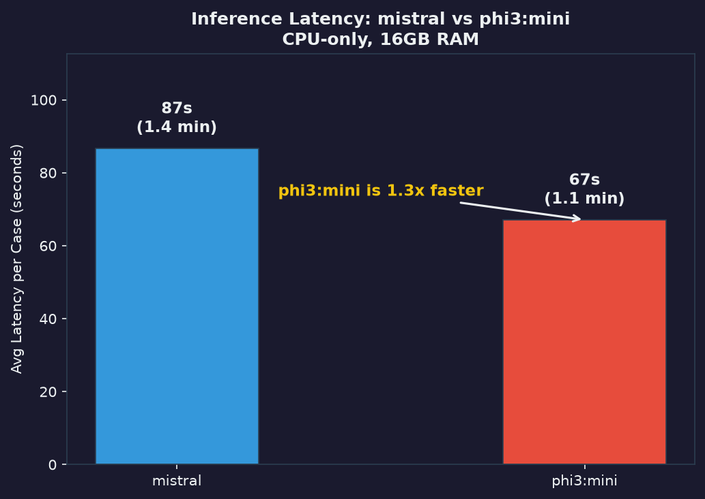

# LLM Evaluation Framework
### Faithfulness & Consistency Evaluation for Document-Grounded QA

---

## What This Is

A framework for evaluating whether LLM answers to document-based questions are actually grounded in the provided context — or just *look* correct because the model has seen similar data during training.

This is not a benchmark. This is a tool for exposing specific failure modes.

**Four dimensions evaluated:**

| Dimension | Question Asked | Where It Runs |
|-----------|---------------|---------------|
| **Faithfulness** | Can every claim in the answer be traced back to the source document? | Pipeline (`--dataset clean`, `--dataset distractor`) + HTTP `/evaluate` |
| **Consistency** | Does the answer remain stable when the question is paraphrased? | Pipeline (`--dataset paraphrase`) |
| **Retrieval Dependency** | Does the answer change when the context is removed or replaced? | Standalone evaluator (`python -m evaluators.retrieval_dependency`) |
| **Sensitivity** | How much does a small prompt perturbation affect the output? | Standalone evaluator (`python -m evaluators.sensitivity`) |

---

## Design Principles

**No LLM judge.** Faithfulness is measured by tracing each extracted claim to an evidence span using semantic similarity — not by asking another model to evaluate the answer. Circular logic is not evaluation.

**No opaque scores.** Every metric can be explained logically. Every failure case is documented with a diagnosis, not just flagged.

**Config-driven.** All thresholds and parameters live in `config.yaml` — no magic numbers buried in code. Recalibration for a new domain means editing one file.

**Failure cases are first-class citizens.** The `reports/analysis.md` documents what went wrong and why — not just aggregate scores.

**Fully local, fully free.** All inference runs via [Ollama](https://ollama.ai). No OpenAI API, no GPU required.

---

## Stack

| Component | Tool |
|-----------|------|
| LLM inference | Ollama (mistral, phi3:mini) |
| Embeddings | nomic-embed-text via Ollama |
| Similarity | Cosine similarity (numpy) |
| Lexical overlap | ROUGE-L (rouge-score) |
| HTTP service | FastAPI + uvicorn |
| Config | PyYAML |
| Reporting | Jinja2 + Matplotlib |
| Dataset | FastAPI documentation (manually curated) |

---

## Project Structure

```
llm-eval-framework/
│
├── data/
│   ├── raw/                          # FastAPI docs source sections
│   └── dataset/
│       ├── clean_cases.json          # 10 baseline QA pairs
│       ├── distractor_cases.json     # 5 cases with modified context
│       └── paraphrase_cases.json     # 6 cases with rephrased questions
│
├── evaluators/
│   ├── faithfulness.py               # Claim extraction + evidence matching (v1.2.2)
│   ├── consistency.py                # Cross-variant answer comparison (v1.0.0)
│   ├── retrieval_dependency.py       # Context manipulation detection (v1.0.0)
│   └── sensitivity.py               # Prompt perturbation robustness (v1.0.0)
│
├── pipeline/
│   ├── runner.py                     # Main orchestrator — resume, retry, dry-run
│   ├── config_loader.py              # Singleton config loader (reads config.yaml)
│   ├── model_client.py               # Ollama wrapper (model-agnostic)
│   └── prompt_templates.py           # All prompts centralized here
│
├── reports/
│   ├── results/                      # JSON outputs (auto-generated, gitignored)
│   ├── charts/                       # PNG visualizations (committed — used by this README)
│   ├── templates/
│   │   └── report.html.j2            # Jinja2 HTML report template
│   ├── visualize.py                  # Chart generator (--chart flag)
│   ├── generate_report.py            # HTML report generator (--embed-charts flag)
│   └── analysis.md                   # Observations and failure cases (real data)
│
├── tests/
│   ├── test_faithfulness.py          # Core evaluator + short-answer helpers
│   ├── test_phase1_features.py       # Branch ordering + technical conflicts
│   ├── test_consistency.py           # Consistency evaluator
│   ├── test_sensitivity.py           # Sensitivity evaluator
│   ├── test_model_client.py          # Ollama client
│   ├── test_runner.py                # Dataset loader + paraphrase/consistency flow
│   └── test_api.py                   # HTTP /evaluate service
│                                     # Total: 184 tests, no Ollama required
│
├── logs/                             # Background run logs + checkpoints
├── api.py                            # FastAPI wrapper — /health, /evaluate (port 8002)
├── config.yaml                       # All thresholds and parameters
├── .github/workflows/test.yml        # CI — auto-run on every push
├── requirements.txt
└── README.md
```

---

## Setup

**1. Install Ollama**
```bash
curl -fsSL https://ollama.ai/install.sh | sh

ollama pull mistral
ollama pull phi3:mini
ollama pull nomic-embed-text
```

**2. Install Python dependencies**
```bash
pip install -r requirements.txt
```

---

## Usage

**Smoke test evaluators — requires only nomic-embed-text (no generation LLM)**
```bash
python -m evaluators.faithfulness
python -m evaluators.consistency
python -m evaluators.sensitivity
python -m evaluators.retrieval_dependency
```

**Validate dataset without inference**
```bash
python pipeline/runner.py --model phi3:mini --dataset clean --dry-run
python pipeline/runner.py --model phi3:mini --dataset paraphrase --dry-run
```

**Run faithfulness evaluation** (clean + distractor datasets)
```bash
# Development (1 case, fast)
python pipeline/runner.py --model phi3:mini --dataset clean --limit 1

# Full eval — resumes automatically if crashed
python pipeline/runner.py --model mistral --dataset clean
python pipeline/runner.py --model mistral --dataset distractor

# Force re-run (ignore existing checkpoints)
python pipeline/runner.py --model mistral --dataset clean --no-resume

# Background process
nohup python pipeline/runner.py --model mistral --dataset clean > logs/run.log 2>&1 &
```

**Run consistency evaluation** (paraphrase dataset — queries every question variant)
```bash
python pipeline/runner.py --model mistral --dataset paraphrase
# Note: consistency runs do not use checkpoint/resume — rerunning restarts all cases.
```

**Run tests**
```bash
pytest tests/ -v
# Expected: 184 passed
```

**Run the HTTP service** (requires Ollama for embeddings)
```bash
uvicorn api:app --host 0.0.0.0 --port 8002
```

**Generate charts**
```bash
python reports/visualize.py                      # all charts
python reports/visualize.py --chart model_comparison
python reports/visualize.py --chart per_case
python reports/visualize.py --chart latency
```

**Generate HTML report**
```bash
# Relative paths (requires charts folder)
python reports/generate_report.py

# Self-contained single file — charts embedded as base64
python reports/generate_report.py --embed-charts --output reports/report.html
```

---

## Configuration

All thresholds live in `config.yaml` at the project root:

```yaml
thresholds:
  faithfulness_evidence: 0.68        # claim must match context span
  insufficient_ctx_validation: 0.65  # ground truth vs context similarity
  consistency_semantic: 0.72         # cross-variant semantic agreement
  consistency_rouge_l: 0.40          # lexical overlap floor
  robustness_sensitivity: 0.85       # perturbation stability threshold
  retrieval_dependency_change: 0.70  # answer change when context is removed/replaced
  short_answer_max_words: 5          # route to exact match path
  short_answer_char_sim: 0.85        # char similarity fallback

models:
  default_eval: "mistral"
  default_dev: "phi3:mini"
  embedding: "nomic-embed-text"

inference:
  timeout_seconds: 900
  max_retries: 3
  retry_backoff_base: 2

pipeline:
  checkpoint_dir: "logs/checkpoints"
  results_dir: "reports/results"

dataset:
  base_dir: "data/dataset"

technical_term_groups:               # terms that must not be confused
  - ["put", "patch", "post", "get", "delete", "head", "options"]
  - ["200", "201", "204", "400", "401", "403", "404", "422", "500"]
  - ["sync", "async", "await"]
  - ["required", "optional"]
  - ["true", "false"]
  - ["json", "xml", "yaml", "toml"]
```

---

## Dataset Design

Three case types, each targeting a different failure mode:

**Clean cases** (`clean_cases.json`) — The answer exists explicitly in the context. Baseline evaluation. If a model fails here, the discussion ends.

**Distractor cases** (`distractor_cases.json`) — Context is intentionally modified: values swapped, critical information removed, or contradictory information inserted. A model that answers confidently despite a corrupted context is a model that cannot be trusted.

**Paraphrase cases** (`paraphrase_cases.json`) — Same question, different formulation. Run via `--dataset paraphrase`: every variant is queried, then the answers are compared with the consistency evaluator. A model whose answer shifts based on how the question is worded is not reliable for production use.

---

## Faithfulness Metric

```
Faithfulness = Supported Claims / Total Claims

where:
  Supported Claim   = claim with cosine similarity ≥ 0.68 (config: faithfulness_evidence)
  Unsupported Claim = claim with no sufficient evidence in context

Special cases:
  Short answer (< 5 words) → exact match path when a dataset ground_truth exists.
  The HTTP /evaluate API does not accept ground_truth, so it instead requires
  the normalized short answer to occur in the supplied context as a whole word
  or phrase (word-boundary match: "patch" does not match inside "dispatch").
  Missing matches score 0.0; an absent ground_truth is never treated as an
  empty-string match, and a punctuation-only answer never matches.
  This avoids embedding similarity for single-token answers such as HTTP methods.

  Technical conflict override → if claim and evidence use different terms
  from the same group (e.g. PUT vs PATCH), similarity is zeroed regardless
  of embedding score. Prevents high topical similarity masking factual error.
```

The HTTP service returns the evaluator version that produced each result:

```json
{
  "faithfulness_score": 1.0,
  "failure_mode": "none",
  "has_failure": false,
  "supported_claims": 3,
  "total_claims": 3,
  "evaluator_version": "1.2.2"
}
```

`evaluator_version` comes from the active `FaithfulnessEvaluator.VERSION`.

---

## Evaluation Results

### Mistral vs phi3:mini — Clean Dataset

| Metric | Mistral | phi3:mini |
|--------|---------|-----------|
| Avg faithfulness | **56.7%** | 46.7% ⚠️ |
| Perfect score (1.0) | 5/10 | 4/10 ⚠️ |
| Failure rate | 50% | 60% ⚠️ |
| False INSUFFICIENT_CTX | 2 | 2 |
| Avg inference latency / case | 463.7s | **222.9s** |
| Total wall time (inference + eval) | 160 min | 77.7 min |

**Mistral is more faithful. phi3:mini is 2.1x faster.** Both models over-trigger INSUFFICIENT_CONTEXT at the same rate — a prompt design issue, not a model-specific one.

> ⚠️ **Historical snapshot — not the current evaluator.** These numbers come from February 2026
> runs, produced *before* the `faithfulness_evidence` threshold was calibrated from 0.75 to 0.68
> and before the short-answer fix reached v1.2.2. The raw `reports/results/*.json` artifacts are
> not committed, so the phi3:mini aggregates (and the pre-fix short-answer cases) **cannot be
> re-verified**. Re-run the pipeline before citing any of these figures; see
> [`reports/analysis.md`](reports/analysis.md) for the full provenance note.

### Mistral — Clean vs Distractor Dataset

| Dataset | Avg Faithfulness | Notes |
|---------|-----------------|-------|
| Clean | 56.7% | Normal context |
| Distractor | **8.3%** | Manipulated context |

Drop from 56.7% → 8.3% confirms: **Mistral follows whatever context it receives — including wrong context.** Garbage in, garbage out.

---

## Charts

**Model Comparison — Mistral vs phi3:mini**


**Per-Case Faithfulness — Mistral vs phi3:mini**


**Faithfulness per case — Clean Dataset**


**Faithfulness per case — Distractor Dataset**


**Clean vs Distractor Comparison**


**Inference Latency**


---

## Key Findings

See [`reports/analysis.md`](reports/analysis.md) for full analysis with raw data. Summary:

1. **False INSUFFICIENT_CONTEXT** — Model refused to answer despite explicit evidence (similarity: 0.7249 and 0.9691). Detected via two-stage validation with separate threshold (0.65).

2. **Claim granularity matters** — Evaluating a sentence with 5 items as one claim produces false positives. `_expand_enumeration()` fixes this, changing score 1.0 → 0.6 for the same answer.

3. **Semantic ≠ Factual** — PUT vs PATCH yields similarity 0.8337 despite being factually different. Technical conflict detection overrides embedding score for terms in the same group.

4. **Embedding limitation** — nomic-embed-text treats semantically identical paraphrases as different (similarity: 0.7677). Threshold empirically calibrated to 0.72 for consistency evaluation.

5. **Short answer blind spot** — Fixed in v1.2.2. Single-word answers use an exact match path instead of semantic similarity; the online API path requires a whole-word/phrase match in the supplied context.

6. **Context-faithful is double-edged** — Distractor dataset proves Mistral follows whatever context it receives. Retrieval quality fully determines answer quality.

---

## Reproducing Results

```
Hardware : 16GB RAM, no GPU (CPU-only)
Models   : mistral (eval), phi3:mini (dev), nomic-embed-text (embeddings)
Latency  : 4-8 minutes per query on CPU
Eval time: ~80-160 minutes for 10 cases depending on model
Checkpoints auto-saved per case (clean/distractor) — safe to interrupt and resume;
consistency runs (paraphrase) do not use checkpoints.
```

Reports and charts are **derived artifacts**: `reports/generate_report.py` and
`reports/visualize.py` read `reports/results/*.json` and refuse to run (with an explicit
error) if the result files are absent. They never fall back to hand-written numbers.

> Note on timing: `avg_latency_seconds` in a summary measures generation time per case only,
> while `total_elapsed_seconds` measures the whole run (generation + faithfulness evaluation).
> They are different quantities — do not divide one by the other.

This is a deliberate tradeoff — reproducibility over speed. Anyone with 16GB RAM can reproduce all results without a GPU or paid API.

---

## Reproducibility Pipeline

Langkah terstruktur dari evaluasi → laporan → verifikasi. Semua dijalankan lewat `Makefile`:

```bash
# 1. Install dependencies (bisa dipasang di Python 3.14+)
make install

# 2. Evaluasi faithfulness (clean + distractor)
#    Checkpoint disimpan per case — aman diinterupsi & di-resume.
make eval

# 3. Evaluasi consistency (paraphrase, opsional)
make eval-paraphrase

# 4. Generate charts + HTML report
#    Dibaca sepenuhnya dari reports/results/*.json; gagal keras jika artefak hilang.
make report

# 5. Regenerate tabel numerik di reports/analysis.md dari artefak
make render-analysis

# 6. Verifikasi reproducibility (guard strict)
#    - Jika tidak ada artefak: skip aman (historical)
#    - Jika ada artefak: cek provenance, threshold, dataset hash, evaluator_version
make verify

# 7. Jalankan semua test
make test

# 7b. Jalankan test dengan coverage
make test-cov

# 7c. Jalankan linter & syntax compilation check
make lint

# 8. Hapus checkpoints/log (hindari hapus artifacts & charts)
make clean-artifacts
```

### Cross-Service Integration (`mcp-gateway` & `rag-research`)
Modul ini menyediakan HTTP API service via FastAPI (`api.py` pada port `8002`) yang mengonsumsi kontrak `POST /evaluate`:
- **Request:** `{"question": "...", "answer": "...", "context": "..."}`
- **Response:** `{"faithfulness_score": 0.95, "has_failure": false, "supported_claims": 2, ...}`
- Digunakan oleh `mcp-gateway` sebagai lapisan verifikasi independen (*independent verification layer*) sebelum meneruskan respons ke klien.

Tiap artefak hasil (`*_faithfulness.json`, `*_summary.json`, `*_consistency.json`) di-commit beserta blok **provenance** (evaluator_version, git_commit, git_dirty, config_snapshot, dataset.sha256, generated_at). Jika artefak ada, `make verify` akan menolak jika drift terdeteksi (mis. threshold config_snapshot berbeda dengan `config.yaml`).

> Catatan: `avg_latency_seconds` = waktu generasi per case, sementara `total_elapsed_seconds` = waktu seluruh run (generasi + evaluasi). Keduanya beda kuantitas — jangan dibagi satu sama lain.

---

## What This Is Not

- Not a general-purpose LLM benchmark
- Not a replacement for human evaluation
- Not a claim about which model is "better"

It is a reusable framework for asking specific, verifiable questions about LLM behavior in document-grounded QA settings.

---

## License

MIT
